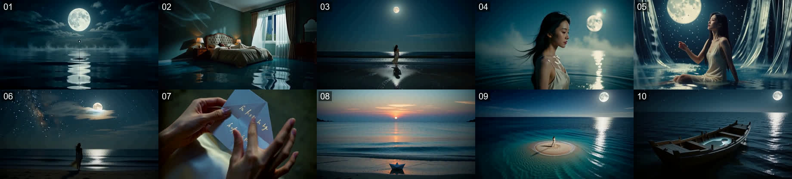
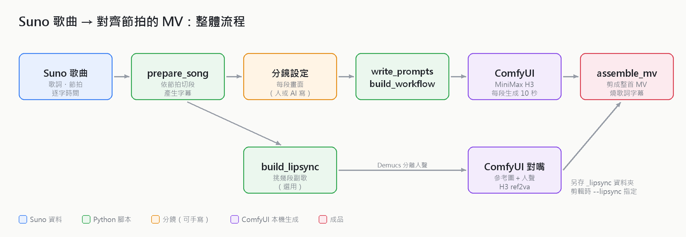
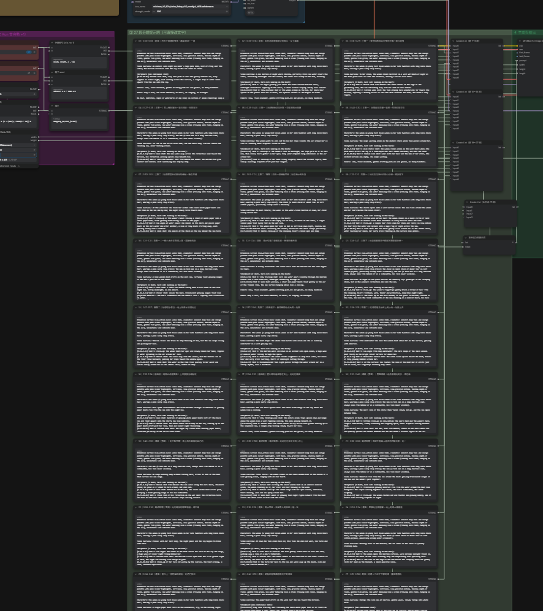
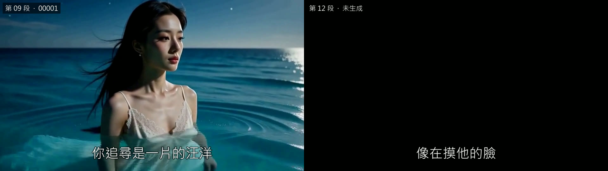
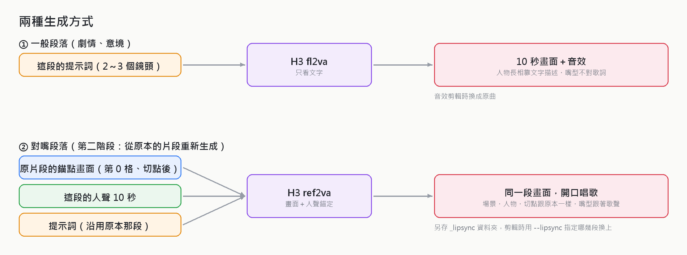
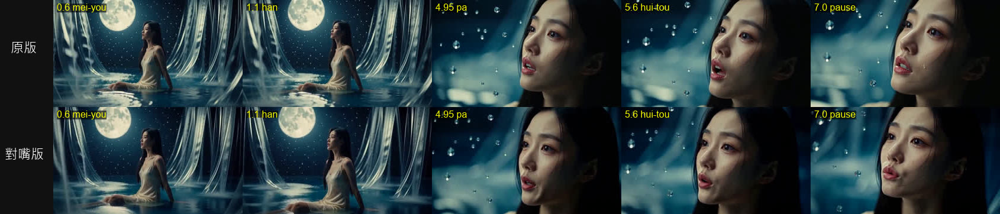
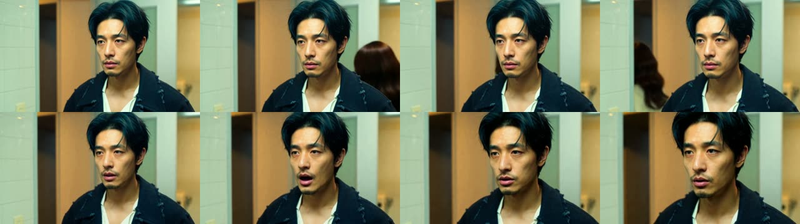
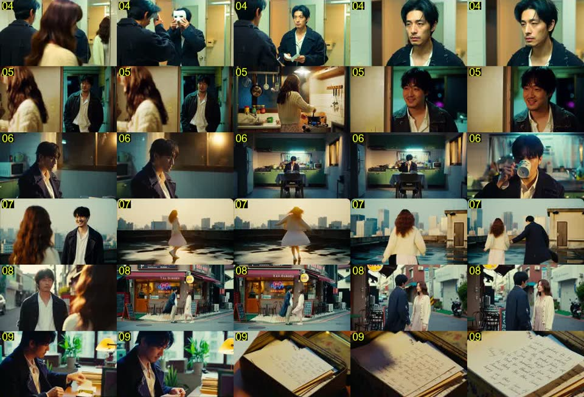
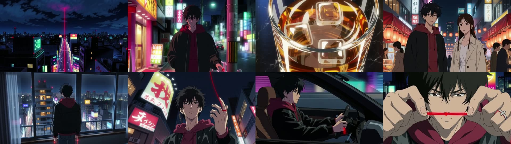
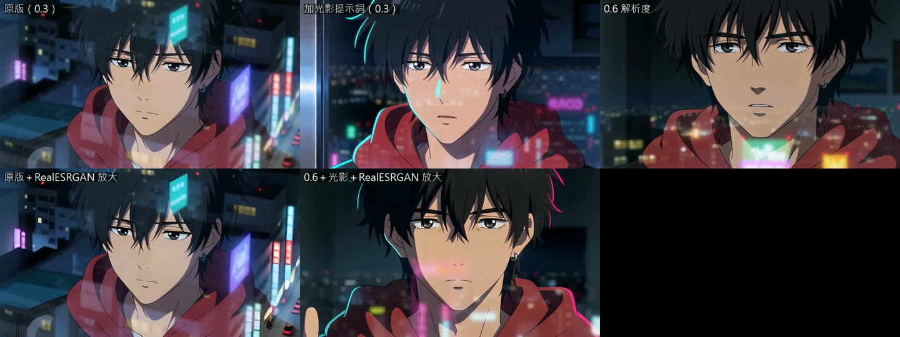

# Suno → ComfyUI MV 工具包（MiniMax H3 本機生成）

把一首 Suno 生成的歌，做成**切點對齊節拍、附歌詞字幕**的完整 MV。
影片在自己電腦的 ComfyUI 上用 **MiniMax H3** 生成，全部是內建節點，不用點數。
副歌可以另外做成**對嘴**段落：人物對著鏡頭唱，嘴型跟著歌聲動。

<p align="center"></p>

<p align="center"></p>
<p align="center"><sub>範例《汪洋》（3:58、27 段）的前 10 段，每段 10 秒、736×416、每段約 5 分鐘</sub></p>

---

## 目錄

- [整體流程](#整體流程)
- [圖文教學：從一首歌到 MV](#圖文教學從一首歌到-mv)
- [對嘴段落（選用）](#對嘴段落選用)
- [重點段落用高畫質重做（選用）](#重點段落用高畫質重做選用)
- [實驗中：MiniMax H3 官方提示詞格式](#實驗中minimax-h3-官方提示詞格式)
- [風格與畫質測試紀錄](#風格與畫質測試紀錄)
- [需要的東西](#需要的東西)
- [各步驟細節](#各步驟細節)
- [檔案](#檔案)

---

## 整體流程



| 步驟 | 做什麼 | 你要動手嗎 |
|---|---|---|
| ① Suno 歌曲 | 取得歌詞（含段落標籤）、節拍、每個字的演唱時間 | 提供歌曲（或請 Claude 透過 Suno 連接器抓） |
| ② `prepare_song.py` | 依節拍把整首歌切成每段約 9 秒，產生字幕 | 執行一行指令 |
| ③ 分鏡設定 | 每段要拍什麼畫面 | 自己寫，或請 AI 依歌詞寫 |
| ④ `write_prompts.py` + `build_workflow.py` | 組成英文提示詞，產生 ComfyUI 工作流程 | 執行兩行指令 |
| ⑤ ComfyUI | 每段生成 10 秒影片 | 拖進 ComfyUI，按 Run |
| ⑥ `assemble_mv.py` | 剪到節拍長度、換上原曲、燒字幕 | 執行一行指令 |

---

## 圖文教學：從一首歌到 MV

### Step 1　準備一個資料夾

```
projects/我的歌/
├─ 我的歌.mp3                原曲
├─ suno_retrieve.json        歌名、風格、帶 [Verse]/[Chorus] 標籤的歌詞
├─ suno_analysis.json        BPM、調性、拍子
└─ suno_alignment.json       每個字的演唱時間
```

三份 JSON 是 Suno API 的回傳內容。用 Claude 搭配 Suno 連接器時，給它歌曲連結，它會幫你存好。

### Step 2　依節拍切段

```
python prepare_song.py projects/我的歌 --folder my_song_mv
```

會產生 `分鏡草稿.md`，打開就能看到每段的時間、段落和歌詞：

| # | 時間 | 長度 | 段落 | 歌詞 | 畫面 |
|---|---|---|---|---|---|
| 03 | 0:17–0:26 | 8.8s | 主歌一 | 你又夢見那片海 / 潮水退得很遠 | （待寫） |
| 04 | 0:26–0:35 | 8.3s | 主歌一 | 他背對著你 / 一直走 一直走 | （待寫） |
| 09 | 1:13–1:22 | 8.8s | 副歌一 | 你追尋是一片的汪洋 / 是你流乾淚水的海洋 | （待寫） |

切點都在拍子上，每個段落從人聲進來前的強拍開始，不會切在一個字唱到一半。

### Step 3　寫分鏡

在資料夾裡建立 `分鏡設定.json`，寫共用風格、角色外型、每段 1～3 個鏡頭：

```jsonc
{
  "style": "Dreamlike surreal live-action music video shot, cinematic: moonlit deep teal …",
  "characters": { "the woman": "a young East Asian woman in her late twenties with long loose black hair …" },
  "shots": {
    "9": { "zh": "她站在汪洋中央的小沙洲，眼淚落下化成整片海",
           "chars": ["the woman"],
           "overview": "The chorus opens into a vast surreal ocean …",
           "shots": ["Wide aerial shot: she stands alone on a tiny sandbar …",
                     "Close-up: a tear falls and the sea rises around her …"] }
  }
}
```

完整範例見 [`examples/汪洋/分鏡表.md`](examples/汪洋/分鏡表.md)。

### Step 4　產生 ComfyUI 工作流程

```
python write_prompts.py  projects/我的歌
python build_workflow.py projects/我的歌
```

得到 `我的歌MV_MiniMaxH3_本機.json`。不管幾段，都會自動排好提示詞節點：

<p align="center"></p>
<p align="center"><sub>拖進 ComfyUI 後的樣子：中間每一格是一段的提示詞（可以直接改文字），右邊每 9 段接一個 Create List</sub></p>

### Step 5　在 ComfyUI 生成

1. 把 `我的歌MV_MiniMaxH3_本機.json` **拖進 ComfyUI**
2. 左邊 `clip_no` 設 **1**，視窗上方 **Run 旁的批次數量設 1**，按 **Run** → 先看第 1 段的畫面和速度
3. 滿意後 `clip_no` 設 **2**、批次數量設**剩下的段數**，按一次 Run，就會一段一段跑完
4. 檔案存在 `ComfyUI/output/my_song_mv/shot_01_00001_.mp4`、`shot_02_…` …

> 某段不滿意：`clip_no` 設那段、`reroll` +1、批次數量 1，按 Run。新檔不會蓋掉舊檔，剪輯時自動用最新的。

### Step 6　剪成 MV

```
python assemble_mv.py --project projects/我的歌 --allow-missing --subs --labels   # 修改用
python assemble_mv.py --project projects/我的歌 --subs                            # 成品
```

修改用版本的左上角會標出「第幾段・哪個版本」，還沒生成的段落是黑畫面，方便邊跑邊看：

<p align="center"></p>

---

## 對嘴段落（選用）



一般段落只看文字生成，人物不會照著歌詞張嘴。對嘴是**第二階段**：所有段落先用一般方式跑完、剪好，看完整支片後，再挑想讓人物開口唱的段落。

對嘴版是**從原本那段片段重新生成**：

- 自動偵測原片段裡的硬切點，把**第 0 格和每個切點後的第一格**當錨點 → 場景、人物、構圖、剪接點都跟原本一樣
- 那段的**人聲**（Demucs 從原曲分離、切出 10 秒）錨定在第 0 格 → 動作和嘴型重新生成，跟著歌聲
- 原本的片段永遠保留，對嘴版另存一個資料夾，剪輯時指定才換上

```
pip install demucs
python build_lipsync_workflow.py projects/我的歌 --shots 5,9
```

1. 產生 `我的歌_對嘴_MiniMaxH3_本機.json`，拖進 ComfyUI
2. `lip_no` 設 1、批次數量設對嘴段數，按 Run
3. 輸出存到**另一個資料夾** `output/<資料夾>_lipsync/`，不會蓋掉原本的段落
4. 剪輯時指定要換上的段落：`python assemble_mv.py --project projects/我的歌 --subs --lipsync 5,9`

<p align="center"></p>
<p align="center"><sub>第 05 段：左邊原版、右邊對嘴版。同一個場景、同一個切點（4.42 秒），右邊跟著「你怕他回頭」開口唱</sub></p>

**有聲示範**（點開播放，聽得到原曲才看得出嘴型）：[第 05 段・原版 vs 對嘴版](docs/videos/lipsync_shot05_compare.mp4)

<p align="center"></p>
<p align="center"><sub>上排原版、下排對嘴版：場景和切點都保留；「回頭」嘴唇嘟圓對得上；人聲時間誤差 0 毫秒</sub></p>

**第二個範例《讓我留下來》**（男聲、35mm 底片風、29 段，其中 7 段對嘴）：

<p align="center"></p>
<p align="center"><sub>第 04 段「臉上藏不住的迷戀」：上排原版嘴巴閉著，下排對嘴版跟著歌聲開口；臉、髮型、背景都一樣</sub></p>

**有聲示範**：[第 04 段・原版 vs 對嘴版](docs/videos/lipsync_letmestay_shot04_compare.mp4)

**怎麼挑對嘴段落：先看縮圖表**

```
python contact_sheet.py projects/我的歌
```

每段抽 5 格畫面拼成 `縮圖表_1.jpg`、`縮圖表_2.jpg`…（每張 10 段），再加一份 `縮圖表.md` 列出每段的歌詞。一眼就能看出哪幾段有臉、有在唱：

<p align="center"></p>
<p align="center"><sub>《讓我留下來》第 04～09 段。04（後半特寫）、05（後半正面）適合對嘴；07 主要是背影和遠景、09 後半是信紙特寫，不適合</sub></p>

- 要**有歌詞**，而且原片段裡**唱歌的人臉要清楚**（特寫、正面最好）。遠景、背影、只有手或物件的段落就算對嘴也看不出來
- 歌是男聲就挑男主角露臉的段落；不露臉的角色（只拍背影的設定）不要挑
- 一段裡只要有一個鏡頭是清楚的臉就值得做，其他鏡頭會照原本的錨點畫面延續
- 交給 Claude 也行：它會看縮圖表和歌詞，挑好段落、產生工作流程並排進佇列
- 想自己寫某段的對嘴提示詞：`--prompts 檔案.json`（`{"5": "…"}`），或在 `分鏡設定.json` 那段加 `"lipsync_prompt"`
- 原片段重抽過的話，重新執行 `build_lipsync_workflow.py`，錨點會換成最新版本的畫面

對嘴版用的是 H3 的 **ref2va** 模型和 4 步 Turbo LoRA，736×416 每段約 3.5 分鐘；整支 MV（29 段＋7 段對嘴）約 3 小時。

---

## 重點段落用高畫質重做（選用）

整支用 0.3 解析度跑完後，只挑重點段落（對嘴、副歌、橋段）用更高的設定重做，其他段落沿用。

1. 複製一份工作流程，把 Resolution 改成 **0.6**（1056×608）、Turbo 關掉（**20 步**），檔名節點的資料夾改成 `<資料夾>_hq`
2. `clip_no` 設要重做的段落，一段一段跑
3. 高畫質段落要對嘴：`python build_lipsync_workflow.py projects/我的歌 --shots 4,12 --clips <ComfyUI>/output/<資料夾>_hq`（輸出到 `<資料夾>_hq_lipsync/`）
4. 剪輯：

```
python assemble_mv.py --project projects/我的歌 --subs --labels --hq 4,10,12 --lipsync 4,12 --hq-note 4=20步,10=8步,12=20步
```

看片版裡，換過的段落左上角是**金底標籤**（「第 04 段 · 高畫質(20步) 對嘴 00001」），其他段落是黑底。成品版（不加 `--labels`）沒有標籤。

| 設定（RTX 3090、每段 10 秒） | 每段時間 |
|---|---|
| 0.3、Turbo 8 步（預設） | 約 5 分鐘 |
| 0.6、Turbo 8 步 | 約 14 分鐘 |
| 0.6、20 步 | 約 31 分鐘 |
| 對嘴 0.6、4 步 | 約 8 分鐘 |

`--hq-clips` 可以指定任何資料夾、`--hq-label` 改標籤文字，所以也能拿來並排比較不同設定（例如下面的 H3 格式）。

---

## 實驗中：MiniMax H3 官方提示詞格式

MiniMax 官方有一份 H3 提示詞寫法（[h3-prompt-writing skill](https://github.com/MiniMax-AI/MiniMax-H3/tree/main/skills/h3-prompt-writing)），用三段式結構，切點寫成 `[Shot 2] At 00:03.500, …`，歌詞寫成 `<d>[Chinese] …</d>`。工具包可以產生這種格式，但**還在比較測試，預設仍是原本的格式**。

```
# 一般段落：寫到另一個檔案，不動原本的 shots.json
python write_prompts.py projects/我的歌 --format h3 --shots-out projects/我的歌_H3/shots.json

# 對嘴段落：Ref2VA 六段式，錨點畫面＝<Picture N>、人聲＝<Audio 1>、歌詞寫進提示詞
python build_lipsync_workflow.py projects/我的歌 --shots 4,12 --format h3 --singer "the man"
```

產生的一般段落提示詞長這樣：

```
integrated_multimodal_description: [Shot 1] …風格、場景、角色… [Shot 2] At 00:03.404, the camera cuts to the next shot. …
  Nobody in the video speaks or sings; every visible face keeps its lips closed. No text, subtitles …
overall_soundscape: Only soft room tone and distant city ambience …
non_diegetic_music: N/A
```

《讓我留下來》12 段的初步比較（同解析度、同 seed）：構圖大致相同，部分鏡頭更貼近分鏡；但也出現新問題（提示詞裡的「面具」被畫成口罩、一段畫面重影）。還需要更多測試才會改成預設。

---

## 風格與畫質測試紀錄

第三首測試歌《紅線斷了》（男聲 R&B ＋ 80 年代 synthwave、98 BPM、32 段）用來測 **2D 動畫風格**和**讓人物更立體鮮明**的方法。以下時間都是 RTX 3090、每段 10 秒。

### 2D 動畫風格（H3 格式＋每個鏡頭重申媒材）

<p align="center"></p>
<p align="center"><sub>90 年代賽璐璐動畫風、霓虹 synthwave 配色。9 段都維持 2D，沒有跑成寫實或 3D；主角（黑髮、黑外套配暗紅帽T、小指上的紅線）9 段都認得出是同一人</sub></p>

做法：`分鏡設定.json` 的 `style` 寫明媒材並排除寫實，另外加 `medium`，`write_prompts.py --format h3` 會在每個 `[Shot N]` 開頭重申一次（MiniMax 官方對非寫實風格的建議）：

```jsonc
"style": "2D hand-drawn anime music video, 1990s Japanese cel animation look: clean ink line art, flat cel shading … not photorealistic, not 3D CG.",
"medium": "2D cel-shaded anime, hand-drawn line art",
"negative": "No text, captions, logos or watermarks; no photorealistic rendering, no live-action footage, no 3D CG look."
```

- **角色一致性比寫實版好很多**：動畫的臉比較簡化，模型比較容易維持同一個人
- 學到的事：
  - 角色要**逐鏡頭**標出場，不要整段一起列。整段列了，只在倒影出現的角色也會被畫進場景
  - 關鍵動作要寫成連續過程（繃緊 → 一根根斷開 → 彈開 → 碎成光點），只寫「斷了」會不明顯
  - 遠景人物要佔畫面至少 1/10，太小會被省略
  - 招牌會出現假文字；要避免就寫「沒有文字的霓虹燈管圖案」

### 讓人物更立體鮮明：五種做法比較

<p align="center"></p>

| 做法 | 立體感 | 清晰度 | 每段時間 |
|---|---|---|---|
| 原版（0.3、8 步） | 光線平 | 普通 | 5 分 |
| **加光影提示詞**（0.3） | ⭐ 最大差別：輪廓光、明暗分明，人物跳出背景 | 同原版 | 5 分 |
| 0.6 解析度 | 普通 | 線條、睫毛更細 | 14 分 |
| 原版＋RealESRGAN 放大 | 同原版 | 線條更銳利，畫面不變 | 5＋5 分 |
| **0.6＋光影＋RealESRGAN** | ⭐ 最好 | ⭐ 最好 | 15＋11 分 |

<p align="center"></p>
<p align="center"><sub>0.6＋光影提示詞＋RealESRGAN：頭髮兩側的青色、洋紅輪廓光，清楚的陰影邊緣，1080p 全螢幕也不糊</sub></p>

光影提示詞（加在 `style` 後面；原本的「soft gradient shadows」改成「crisp hard-edged shadows」）：

```
Strong cinematic lighting for depth: bright magenta and cyan rim light outlining hair and shoulders,
crisp cel-shaded shadows with hard clean edges on faces and clothing, high contrast between lit and
shadow sides, sharp focus on the characters' faces.
```

RealESRGAN 放大在 ComfyUI 用內建節點就能做：`LoadVideo → GetVideoComponents → UpscaleModelLoader(RealESRGAN_x4) → ImageUpscaleWithModel → ImageScale(1920×1080) → CreateVideo → SaveVideo`。

**建議組合**：

| 段落 | 設定 |
|---|---|
| 全部段落 | 光影提示詞＋0.3 |
| 臉部特寫、對嘴、副歌（6～8 段） | 0.6＋光影＋RealESRGAN |

整支約 6～7 小時。改變解析度或提示詞時，同一個 seed 的構圖也會改變。

### 時間估算（每段 10 秒）

0.3、0.6 是實測，其他依「解析度加倍、每步約 3 倍時間」推估：

| megapixels | 尺寸 | 8 步 | 20 步 |
|---|---|---|---|
| 0.3 | 736×416 | 5 分（實測） | 11 分 |
| 0.4 | 832×480 | 8 分 | 18 分 |
| 0.5 | 960×544 | 11 分 | 25 分 |
| 0.6 | 1056×608 | 14 分（實測） | 31 分（實測） |
| 0.8 | 1216×672 | 22 分 | 51 分 |
| 1.0 | 1344×768 | 30 分 | 72 分 |

0.8 以上，顯示卡記憶體可能不夠放 10 秒（243 格），會更慢或失敗，請先跑一段實測。

### 跑的時候電腦很卡／生成卡住

- **電腦很卡**：H3 跑起來會把 24 GB 顯示卡吃滿。在 ComfyUI 啟動參數加 `--reserve-vram 3`，保留 3 GB 給桌面和瀏覽器；實測生成速度沒有變慢。
  - **Comfy Desktop 新版**的啟動參數存在 `%APPDATA%\Comfy Desktop\installations.json` 的 `launchArgs`，不是 ComfyUI 設定裡的 `Comfy.Server.LaunchArgs`。
  - 要改的話，先完全關掉 Desktop 再改，改完確認啟動紀錄（`user/comfyui_8000.log` 的 `Args:`）裡有這個參數。
- **生成卡住**：遇過一次，取樣第一步就卡了 46 分鐘（使用率 100%、沒有報錯）。重開 ComfyUI 就恢復正常。
  - 排大量工作時，建議一段一段送，並加看門狗：例如第一步超過 3～7 分鐘沒進展就自動中斷。

---

## 需要的東西

- **ComfyUI**（新版，要有內建的 MiniMax H3 節點）
- **MiniMax H3 模型**，放進 `ComfyUI/models/`（下載：<https://huggingface.co/Comfy-Org/MiniMax-H3>）

  | 資料夾 | 檔名 | 大小 | 用在 |
  |---|---|---|---|
  | `diffusion_models/` | `minimax_h3_fl2va_pruned_int8_convrot.safetensors` | 19.5 GB | 一般段落 |
  | `diffusion_models/` | `minimax_h3_ref2va_pruned_int8_convrot.safetensors` | 19.5 GB | 對嘴（選用） |
  | `text_encoders/` | `qwen3vl_32b_minimax_h3_nvfp4_awq.safetensors` | 14.6 GB | 都要 |
  | `vae/` | `minimax_h3_video_vae_int8_convrot.safetensors` | 2.6 GB | 都要 |
  | `vae/` | `minimax_h3_audio_vae_fp32.safetensors` | 0.6 GB | 都要 |
  | `loras/` | `minimax_h3_fl2v_turbo_8step_v1.0_comfyui_bf16.safetensors` | 1.8 GB | 一般段落（[lightx2v](https://huggingface.co/lightx2v/Minimax-h3-Turbo)） |
  | `loras/` | `minimax_h3_ref2v_turbo_4step_v0.1_comfyui_bf16.safetensors` | 1.8 GB | 對嘴（選用） |

- **Python 3.8+**、**ffmpeg**（Windows：`winget install ffmpeg`）
- 對嘴另需 `pip install demucs`（第一次分離會下載約 80 MB 的模型）

---

## 各步驟細節

### Suno 資料的精簡格式

```jsonc
// suno_analysis.json：只存強拍，其餘拍子會自動補上
{"bpm": 108.2, "duration_s": 238.4, "key": "F minor", "time_signature": 4,
 "downbeats": [2.364, 6.779, 11.197, ...]}

// suno_alignment.json：每個字 [文字, 開始秒, 結束秒]，"\n" 代表換句
{"words": [["你", 18.254, 18.569], ["又", 18.569, 18.649], ["\n潮", 22.632, 22.712], ...]}
```

也接受 Suno API 的原始格式（`/audio/{id}`、`/audio/{id}/analysis`、`/audio/{id}/lyrics-alignment`）。

### prepare_song.py

- 每段 4～10 秒（理想 8.8 秒），切點在拍子上，優先強拍
- 歌詞唱完後的器樂尾奏另成一段；字幕前後句不重疊（字幕高度不會跳）
- 想少幾段：`--target 9.5`；多幾段：`--target 7.5`

### write_prompts.py

每段的鏡頭時間依那段實際長度、對齊拍子分配，產生的提示詞結構：

```
[共用風格]
Characters: [這段出場的角色和外型]
Scene overview: …
Storyboard (2 shots, hard cuts landing on the beat):
[0.0s-3.4s] Shot 1: …
[3.4s-10.0s] Shot 2: …
Camera: … / Audio: … / No text, subtitles, logos or watermarks …
```

- `--format h3`：改用 MiniMax 官方三段式（實驗中，見上方說明）
- `--shots-out 檔案.json`：寫到別的檔案，不覆寫 `shots.json`
- `分鏡設定.json` 加 `"medium"`（例如 `2D cel-shaded anime`）：`--format h3` 時每個 `[Shot N]` 開頭都會重申，動畫風格比較不會跑成寫實

### build_workflow.py

以 `templates/MiniMaxH3_本機_範本.json` 為範本，依段數重建提示詞節點。CreateList 一個最多 10 個輸入，所以每 9 段一組再合併（最多 90 段）。改範本（解析度、步數…），之後產生的都會跟著改。

- **解析度**：預設 megapixels 0.3（736×416）；要更清楚改 0.6（1056×608）或 0.98（1344×768），會慢很多
- **Turbo**：預設 8 步；關掉 = 20 步，畫質好一些，約慢 2.5 倍

### build_lipsync_workflow.py

- `--shots` 對嘴段落（一次最多 10 段）；那幾段要先有原本的片段
- 自動偵測原片段的硬切點（最多 2 個），抽出錨點畫面放進 `ComfyUI/input/`；解析度跟原片段一樣
- `--face` 選用：再加一張臉部參考圖，讓長相更穩定
- `lip_no` 會自動帶出那段的人聲起點、錨點畫面和影格、段落編號、提示詞、檔名
- 自訂對嘴提示詞：`--prompts 檔案.json`，或在 `分鏡設定.json` 那段加 `"lipsync_prompt": "..."`
- 輸出到 `output/<資料夾>_lipsync/`，和一般段落分開
- `--clips <資料夾>`：改用別的資料夾的片段當原片（例如高畫質版 `<資料夾>_hq`），輸出到 `<那個資料夾>_lipsync/`
- `--format h3`、`--singer "the man"`：官方 Ref2VA 六段式對嘴提示詞（實驗中）；`--singer` 指定唱歌的角色，其他人會加上「嘴巴閉著」

### contact_sheet.py

- 每段在 6%、30%、54%、78%、96% 的位置各抽一格，左上角標段號
- `--lipsync`：改看對嘴版（`_lipsync` 資料夾），可以跟原版的縮圖表對照
- `--per-sheet 10`：每張幾段；`--width 240`：每格寬度

### assemble_mv.py

- 依 `shots.json` 把每段剪到精確影格數、接起來、換上原曲
- 同一段有多個版本時，自動用編號最大（最新）的
- `--lipsync 9,22`：這幾段換成 `_lipsync` 資料夾裡的對嘴版（`--lipsync all` = 有對嘴版的全部換）；左上角標籤會標「對嘴」
- `--hq 4,12`：這幾段換成 `<資料夾>_hq`（或 `--hq-clips` 指定的資料夾）的版本，標籤改成金底；`--hq-label` 改標籤文字、`--hq-note 4=20步` 加附註。和 `--lipsync` 一起用時，會用 `<高畫質資料夾>_lipsync` 的對嘴版
- 1920×1080、24fps、H.264 + AAC 320k，開頭淡入、結尾淡出
- ComfyUI output 位置預設 `~/Documents/ComfyUI/output`，可用環境變數 `COMFYUI_OUTPUT` 或 `--comfy-output` 指定
- 其他選項：`--fontsize 34`、`--marginv 10`（字幕大小和高度）、`--size native`

---

## 檔案

| 檔案 | 用途 |
|---|---|
| `prepare_song.py` | Suno 資料 → 切點、字幕、分鏡草稿 |
| `write_prompts.py` | 分鏡設定 → 英文提示詞 |
| `build_workflow.py` | shots.json → ComfyUI 工作流程 |
| `build_lipsync_workflow.py` | 指定段落 → 對嘴版 ComfyUI 工作流程 |
| `assemble_mv.py` | 生成的片段 + 原曲 → 完整 MV |
| `contact_sheet.py` | 每段抽畫面拼成縮圖表，挑對嘴段落或檢查整支片用 |
| `templates/MiniMaxH3_本機_範本.json` | ComfyUI 工作流程範本（全部內建節點） |
| `templates/object_info_lipsync.json` | 對嘴工作流程用到的節點定義快照（連不到 ComfyUI 時使用） |
| `examples/汪洋/` | 完整範例：分鏡表、提示詞、字幕、工作流程 |
| `docs/` | 本頁的圖片和示範短片 |

## 授權提醒

MiniMax H3 使用 MiniMax H3 Community License，美國、歐盟、英國、韓國不在授權範圍內；
商用前請先看 <https://huggingface.co/MiniMaxAI/MiniMax-H3> 的條款。
範例歌曲《汪洋》《讓我留下來》的音樂只以 10 秒內的示範片段收錄於 `docs/videos/`。
